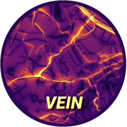

<!-- README.md is generated from README.Rmd. Please edit that file -->

<!-- date: "19 de Octubre de 2016" -->

# VEIN 

- build: [](https://ci.appveyor.com/project/ibarraespinosa/vein)
- cran:
  [](http://cran.rstudio.com/web/packages/vein/index.html)
  [](http://cran.r-project.org/web/packages/vein)
  [](http://cran.r-project.org/package=vein)
  [](https://www.tidyverse.org/lifecycle/#maturing)
  
- doi:
  [](https://zenodo.org/badge/latestdoi/88201850)
- github: [](https://github.com/atmoschem/vein)
  
  
  <!--  -->
  
  [](https://github.com/atmoschem/vein/actions)

<!--  -->

# **V**ehicular **E**missions **IN**ventories (VEIN)

<figure>

<figcaption aria-hidden="true">vein</figcaption>
</figure>

### Speed-dependent inventories

`emis_speed()` estimates hourly emissions per street with
speed-dependent emission factors. The EMEP/EEA driving-cycle curves used
by `ef_ldv_scaled()` / `ef_hdv_scaled()` are compiled to a small stack
machine and evaluated with an OpenMP C kernel (`src/e_speed.c`). Ages
sharing the same equation are grouped, so each curve is evaluated once
per street-hour. The result matches `emis()` to machine precision and is
6-17 times faster on a laptop, which makes country-scale hourly
inventories (hundreds of thousands of links) feasible. See the
`brazil_bu_speed` project and the step-by-step article [Understanding
speed-dependent inventories with
emis_speed](https://atmoschem.github.io/vein/articles/speed.html).

### Emission factors

Light-duty hot emission factors (`ef_ldv_speed()`, `ef_ldv_scaled()`,
`emis_speed()`, `ef_eea()`) come from the EMEP/EEA air pollutant
emission inventory guidebook 2023 - update 2026 (Appendix 4, July 2026).
Fuel consumption is derived from the energy consumption factors, and CO2
from fuel with the carbon balance, so CO2/FC is constant. Other sources
are CETESB (Brazil), the Chinese guidelines, MOVES and EMFAC.

### HBEFA

`emis_hbefa()`, `ef_hbefa()`, `ef_hbefa_cycle()` and `hbefa_classes()`
are an R port of the HBEFA-based emission models (HBEFA v4.2, v3.1 and
v2.1) of [Eclipse SUMO](https://eclipse.dev/sumo/), with 962 vehicle
classes. They give instantaneous emissions from speed and acceleration,
constant-speed factors, and averages over driving cycles, as an
alternative to COPERT/EMEP-EEA for European projects. These files are
EPL-2.0 OR GPL-2.0-or-later, see `inst/COPYRIGHTS`, and the article
[HBEFA emission
models](https://atmoschem.github.io/vein/articles/hbefa.html).

### MOVES factors without a database

`moves_factors()` loads local MOVES data and `ef_moves()` evaluates
running-exhaust factors in R on Linux, macOS and Windows. Evaluation
needs no MariaDB, SQL, Java or MOVES installation.

Select the vehicle with `source_type_id`, the fuel with `fuel_type_id`,
and its manufacturing year with `model_year`. Both MOVES numeric IDs and
exact names are accepted. For example:

``` r
vein::ef_moves(
  pollutant = "NOx",
  source_type_id = "Passenger Car",
  fuel_type_id = "Gasoline",
  model_year = 2020,
  speed = c(20, 40, 60),  # km/h
  temperature = 20        # degrees C
)
#> Units: [g/km]
#> [1] 0.011671836 0.010784581 0.009399917
```

The bundled reference data cover **all 13 MOVES on-road vehicle types**
and 38 vehicle/fuel combinations with running-exhaust output (gasoline,
diesel, E-85, CNG and electricity), for **CO and NOx**, model years
**2000–2025**, inventory year **2025**, and an urban unrestricted road.
They include 16 speed bins and temperatures of 10, 20 and 30 degrees C
at 50% relative humidity, using a documented U.S. reference scenario.
Vehicle age is inventory year minus model year: a model-year 2020 car is
five years old in this dataset.

Use `moves_vehicles()` to list the available source-type and fuel IDs by
name. For example, a diesel combination long-haul truck:

``` r
vein::moves_vehicles()
#>    sourceTypeID               sourceTypeName fuelTypeID
#> 1            11                   Motorcycle          1
#> 2            21                Passenger Car          1
#> 3            21                Passenger Car          2
#> 4            21                Passenger Car          5
#> 5            21                Passenger Car          9
#> 6            31              Passenger Truck          1
#> 7            31              Passenger Truck          2
#> 8            31              Passenger Truck          5
#> 9            31              Passenger Truck          9
#> 10           32       Light Commercial Truck          1
#> 11           32       Light Commercial Truck          2
#> 12           32       Light Commercial Truck          5
#> 13           32       Light Commercial Truck          9
#> 14           41                  Other Buses          1
#> 15           41                  Other Buses          2
#> 16           41                  Other Buses          3
#> 17           42                  Transit Bus          1
#> 18           42                  Transit Bus          2
#> 19           42                  Transit Bus          3
#> 20           43                   School Bus          1
#> 21           43                   School Bus          2
#> 22           43                   School Bus          3
#> 23           51                 Refuse Truck          1
#> 24           51                 Refuse Truck          2
#> 25           51                 Refuse Truck          3
#> 26           52 Single Unit Short-haul Truck          1
#> 27           52 Single Unit Short-haul Truck          2
#> 28           52 Single Unit Short-haul Truck          3
#> 29           53  Single Unit Long-haul Truck          1
#> 30           53  Single Unit Long-haul Truck          2
#> 31           53  Single Unit Long-haul Truck          3
#> 32           54                   Motor Home          1
#> 33           54                   Motor Home          2
#> 34           61 Combination Short-haul Truck          1
#> 35           61 Combination Short-haul Truck          2
#> 36           61 Combination Short-haul Truck          3
#> 37           62  Combination Long-haul Truck          2
#> 38           62  Combination Long-haul Truck          3
#>                    fuelTypeDesc
#> 1                      Gasoline
#> 2                      Gasoline
#> 3                   Diesel Fuel
#> 4                Ethanol (E-85)
#> 5                   Electricity
#> 6                      Gasoline
#> 7                   Diesel Fuel
#> 8                Ethanol (E-85)
#> 9                   Electricity
#> 10                     Gasoline
#> 11                  Diesel Fuel
#> 12               Ethanol (E-85)
#> 13                  Electricity
#> 14                     Gasoline
#> 15                  Diesel Fuel
#> 16 Compressed Natural Gas (CNG)
#> 17                     Gasoline
#> 18                  Diesel Fuel
#> 19 Compressed Natural Gas (CNG)
#> 20                     Gasoline
#> 21                  Diesel Fuel
#> 22 Compressed Natural Gas (CNG)
#> 23                     Gasoline
#> 24                  Diesel Fuel
#> 25 Compressed Natural Gas (CNG)
#> 26                     Gasoline
#> 27                  Diesel Fuel
#> 28 Compressed Natural Gas (CNG)
#> 29                     Gasoline
#> 30                  Diesel Fuel
#> 31 Compressed Natural Gas (CNG)
#> 32                     Gasoline
#> 33                  Diesel Fuel
#> 34                     Gasoline
#> 35                  Diesel Fuel
#> 36 Compressed Natural Gas (CNG)
#> 37                  Diesel Fuel
#> 38 Compressed Natural Gas (CNG)
vein::ef_moves(
  pollutant = "NOx",
  source_type_id = "Combination Long-haul Truck",
  fuel_type_id = "Diesel Fuel",
  model_year = 2020, speed = c(20, 40, 60), temperature = 20
)
#> Units: [g/km]
#> [1] 6.788542 3.318675 2.208248
```

Start exhaust (`ef_moves_start()`) and evaporative factors
(`ef_moves_evap()`) are separate event-based data in **g/start** and
**g/vehicle per hour**. They cannot be used as g/km factors in `emis()`;
multiply them by the number of starts or vehicles. Use
`moves_start_factors()` and `moves_evap_factors()` to load them. Brake
and tire wear and evaporative emissions while driving are distance
factors: select them in `ef_moves()` with `process = "brake"`, `"tire"`,
`"permeation"`, `"venting"` or `"leaks"`.

Other scenarios, pollutants or model years require additional factor
data, which [movesr](https://github.com/atmoschem/movesr) generates: a
standalone R port of the MOVES rate engine (no Java, MariaDB or MOVES)
whose `movesr_export_vein()` writes the tables read by `moves_factors()`,
`moves_start_factors()` and `moves_evap_factors()` for any county, year,
month, weather and fuel. Omit `speed` to obtain a function for `EmissionFactorsList()` and
`emis()`, or use `method = "linear"` for bounded interpolation between
speed-bin factors. See [MOVES emission factors in
R](https://atmoschem.github.io/vein/articles/moves_factors.html) for the
arguments, available conditions, examples and data provenance.

### TODO

- See issues [GitHub](https://github.com/atmoschem/vein/issues)
- Second edition of my book

### System requirements

vein imports functions from spatial packages listed below. In order to
install these packages, firstly the user must install the requirements
mentioned [here](https://www.github.com/r-spatial/sf).

### Installation

#### r-universe or CRAN

VEIN can be installed via CRAN or github

``` r
install.packages('vein', repos = c('https://atmoschem.r-universe.dev', 'https://cloud.r-project.org'))
```

#### GitHub

``` r
remotes::install_github("atmoschem/vein")
```

## Run with a project

Use the function
[get_project](https://atmoschem.github.io/vein/reference/get_project.html)
and read the documentation, there you can see more projects as well.

``` r
library(vein)
```

``` r
awesome_city <- tempdir()
awesome_city
#> [1] "/tmp/RtmpYYM6af"
get_project(directory = awesome_city,
case = "brazil_bu_chem")
#> Your directory is in /tmp/RtmpYYM6af
```

``` r
system(paste0("tree ", awesome_city))
```

You have to open the file `main.Rproj` with Rstudio and then open and
run `main.R`

To run `main.R` you will need these extra packages:

- ggplot2
- readxl
- eixport (If you plan to generate WRF Chem emissions file)

If you do not have them already, you can install:

``` r
install.packages(c("ggplot2", "readxl", "eixport"))
```

Check the projects
[here](https://atmoschem.github.io/vein/reference/get_project.html)

<figure>

<figcaption aria-hidden="true">vein proejcts</figcaption>
</figure>

## Too complicated? Watch a YouTube

<iframe width="560" height="315" src="https://www.youtube.com/embed/tHSWIjg26vg" frameborder="0" allow="accelerometer; autoplay; clipboard-write; encrypted-media; gyroscope; picture-in-picture" allowfullscreen>

</iframe>

[English](https://www.youtube.com/embed/tHSWIjg26vg)

<iframe width="560" height="315" src="https://www.youtube.com/embed/6-07Y0Eimng" frameborder="0" allow="accelerometer; autoplay; clipboard-write; encrypted-media; gyroscope; picture-in-picture" allowfullscreen>

</iframe>

[Portuguese](https://www.youtube.com/watch?v=6-07Y0Eimng)

## Check some of my presentations

[presentation and some papers](https://github.com/topics/ibarraslides)

Thanks and enjoy VEIN!

## Citation

If you use VEIN, please, cite it
([BIBTEX](https://gmd.copernicus.org/articles/11/2209/2018/gmd-11-2209-2018.bib),
[ENDNOTE](https://gmd.copernicus.org/articles/11/2209/2018/gmd-11-2209-2018.ris)):

Ibarra-Espinosa, S., Ynoue, R., O’Sullivan, S., Pebesma, E., Andrade, M.
D. F., and Osses, M.: VEIN v0.2.2: an R package for bottom-up vehicular
emissions inventories, Geosci. Model Dev., 11, 2209-2229,
<https://doi.org/10.5194/gmd-11-2209-2018>, 2018.

    @article{gmd-11-2209-2018,
    author = {Ibarra-Espinosa, S. and Ynoue, R. and O'Sullivan, S. and Pebesma, E. and Andrade, M. D. F. and Osses, M.},
    title = {VEIN v0.2.2: an R package for bottom--up vehicular emissions inventories},
    journal = {Geoscientific Model Development},
    volume = {11},
    year = {2018},
    number = {6},
    pages = {2209--2229},
    url = {https://gmd.copernicus.org/articles/11/2209/2018/},
    doi = {10.5194/gmd-11-2209-2018}
    }

[Google
Scholar](https://scholar.google.com/scholar?q=VEIN+v0.2.2%3A+an+R+package+for+bottom%E2%80%93up+vehicular+emissions+inventories)

<div id="metrics-365-60926-crossref"
class="metrics-tile metrics-tile-crossref low-opacity">

<a href="javascript:void(0);" title="Toggle crossref metric details">

</a>

<div class="metrics-tile-footer">

<a href="javascript:void(0);" title="Toggle crossref metric details">50</a>

</div>

</div>

## Special thanks to all the contributors

[](https://github.com/atmoschem/vein/graphs/contributors)

## Communications, doubts etc

- Earth-Sciences on Stackoverflow, tag
  [vein-r-package](https://earthscience.stackexchange.com/questions/tagged/vein-r-package)
- Drop me an email <sergio.ibarraespinosa@colorado.edu> or
  <zergioibarra@hotmail.com> (你好中国朋友 - Hello Chinese friends!)
- Check the group on GoogleGroups
  [Group](https://groups.google.com/d/forum/veinmodel).

## Issues

If you encounter any issues while using VEIN, please submit your issues
to: <https://github.com/atmoschem/vein/issues/> If you have any
suggestions just let me know to <sergio.ibarra@usp.br>.

### Contributing

Please, read
[this](https://github.com/atmoschem/vein/blob/master/CONTRIBUTING.md)
guide. Contributions of all sorts are welcome, issues and pull requests
are the preferred ways of sharing them. When contributing pull requests,
please follow the [Google’s R Style
Guide](https://google.github.io/styleguide/Rguide.xml).

### Note for non-english and anaconda users

Sometimes you need to install R and all dependencies and a way for doing
that is using anaconda. Well, as my system is in portuguese, after
installing R using anaconda it changed the decimal character to ‘,’. In
order to change it back to english meaning decimal separator as ‘.’, I
added this variable into the .bashrc

    nano ~/.bashrc
    export Lang=C

More details on
[StackOverflow](https://stackoverflow.com/questions/13575180/how-to-change-language-settings-in-r)

<!-- You can learn more about VEIN reading the documentation in [PDF](https://cran.r-project.org/web/packages/vein/vein.pdf), [online](https://atmoschem.github.io/vein/), reading the book [online](https://ibarraespinosa.github.io/VEINBOOK/), or buy it in  [Kindle](https://www.amazon.com/VEINBOOK-Estimating-vehicular-emissions-package-ebook-dp-B07L7XRFKC/dp/B07L7XRFKC/ref=mt_kindle?_encoding=UTF8&me=&qid=) or  [Paperback](https://www.amazon.com/gp/product/1791571158?pf_rd_p=1581d9f4-062f-453c-b69e-0f3e00ba2652&pf_rd_r=EMDPZM3G7BWCHAD9F4QP) -->

<!--  -->

**Stargazers**

<p>

<a href="https://github.com/atmoschem/vein/stargazers">
 </a>
</p>
